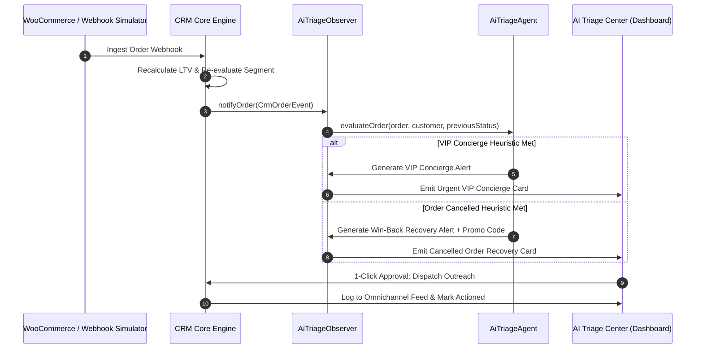

# AI Usage & Agentic Architecture Guide — Kilowott CRM

This document details the agentic workflows, artificial intelligence architecture, prompt formulations, and design patterns utilized in the development and operation of the **Kilowott CRM WooCommerce System Integration**.

---

## 1. Embedded Agentic AI: The Triage Agent

The platform features an embedded **AI Triage Agent** (`AiTriageAgent` in [`src/lib/ai-triage.ts`](file:///d:/hackathon-kilowott-crm/kilowott-crm/src/lib/ai-triage.ts)), integrated into the system via the **Observer Pattern** (`AiTriageObserver`).

Whenever an order lifecycle event occurs (e.g., an order is created, advanced, or cancelled), the engine dispatches a strongly-typed event (`CrmOrderEvent`). The AI Triage Observer intercepts this event and conducts autonomous context evaluation.

---

## 2. Agentic Triage Workflows

### 2.1 VIP Concierge Alert Agent
- **Trigger Conditions**:
  - The customer's segment is `VIP` (LTV ≥ $500), OR
  - The incoming order total is ≥ $500, OR
  - The order elevates the customer's cumulative LTV into the VIP tier.
- **Analysis Synthesis**:
  - Aggregates the patron's lifetime spend, average order value, historical order frequency, and current line items.
  - Generates recommended white-glove action items:
    - *Example*: "Assign dedicated account concierge, flag warehouse for premium luxury packaging, and send executive WhatsApp acknowledgment."
- **Autonomous Outreach Generation**:
  - Synthesizes personalized WhatsApp copy tailored to the patron's status:
    > *"Hello Elena, thank you for choosing Kilowott. As one of our esteemed VIP patrons, your order #1079 ($620.00) has been expedited with complimentary priority dispatch. If you have any bespoke requests, your dedicated concierge is at your service."*
- **Actionability**:
  - Provides a 1-click **"Dispatch VIP Concierge (WhatsApp)"** action that dispatches the message into the omnichannel communication ledger and marks the alert actioned.

---

### 2.2 Cancelled-Order Win-Back Recovery Agent
- **Trigger Conditions**:
  - An order transitions to `cancelled` status (`order.status === "cancelled"`).
- **Analysis Synthesis**:
  - Identifies abandoned line items, monetary value, and customer retention tier.
  - Recognizes potential checkout abandonment or buyer friction.
- **Dynamic Discount Coupon Generation**:
  - Formulates a unique, deterministic promotional voucher code: `COMEBACK-{wooCommerceOrderId}` (e.g., `COMEBACK-1077`).
  - Adjusts incentive depth dynamically based on customer tier (e.g., 20% for VIPs, 15% for Repeat/New customers).
- **Autonomous Outreach Generation**:
  - Synthesizes an empathetic, high-converting win-back email:
    > *"Hi Marcus,\n\nWe noticed your recent order #1077 (Wireless Hi-Res Studio Monitors) was cancelled. If something didn't go quite right, we'd love the opportunity to assist you.\n\nTo welcome you back, use exclusive voucher code COMEBACK-1077 at checkout for 15% off your next order valid for the next 48 hours.\n\nWarm regards,\nThe Kilowott Concierge Team"*
- **Actionability**:
  - Provides a 1-click **"Dispatch Win-Back Campaign (Email)"** action that injects the recovery message directly into the customer's communication history.

---

## 3. Human-in-the-Loop (HITL) Guardrails

To prevent hallucinated or unintended customer communication:
1. **Approval Gateways**: While the AI Triage Agent generates the analysis, suggested coupon codes, and message copy autonomously, the team member reviews the alert in the **AI Agent Triage Center** before dispatching.
2. **Deduplication Check**: The `AiTriageObserver` enforces uniqueness constraints to prevent duplicate pending alerts for the same order and triage type.
3. **Audit Trail**: Every actioned triage recommendation is permanently stamped with a timestamp and logged into the **Omnichannel Communication Feed** with channel delivery confirmations.

---

## 4. AI in the Development Lifecycle

AI tools were employed systematically during the implementation of this project:

| Phase | AI Application & Workflow | Output Deliverable |
|:---|:---|:---|
| **Architectural Planning** | Formulated software architecture diagrams, design pattern mappings, and guest checkout deduplication strategies. | [`implementation_plan.md`](file:///C:/Users/saish/.gemini/antigravity-ide/brain/400f9aa3-fc1f-452f-9523-74b6bbceca9c/implementation_plan.md) |
| **Adapter Pattern Engineering** | Normalized WooCommerce webhook payload variations, handling guest checkouts (`customer_id = 0`). | [`WooCommerceAdapter`](file:///d:/hackathon-kilowott-crm/kilowott-crm/src/lib/crm-engine.ts#L17) |
| **Strategy Pattern Implementation** | Constructed pluggable, swappable customer segmentation algorithms (`TieredLtvStrategy`, `FrequencyStrategy`, `HybridRfmStrategy`). | [`SegmentationStrategy`](file:///d:/hackathon-kilowott-crm/kilowott-crm/src/lib/crm-engine.ts#L182) |
| **Observer Pattern Implementation** | Decoupled state changes from automated side-effects (Email/WhatsApp logs, AI alerts, analytics). | [`WorkflowEngine`](file:///d:/hackathon-kilowott-crm/kilowott-crm/src/lib/crm-engine.ts#L295) |
| **Automated Testing Generation** | Authored 15 unit tests in Vitest and an end-to-end suite in Playwright with high branch coverage. | [`crm-engine.test.ts`](file:///d:/hackathon-kilowott-crm/kilowott-crm/src/lib/__tests__/crm-engine.test.ts), [`crm.spec.ts`](file:///d:/hackathon-kilowott-crm/kilowott-crm/e2e/crm.spec.ts) |
| **Modern UX/UI Synthesis** | Implemented rich Tailwind CSS glassmorphic cards, glowing badges, 360° drawer, and live webhook simulator. | [`src/app/page.tsx`](file:///d:/hackathon-kilowott-crm/kilowott-crm/src/app/page.tsx) |
