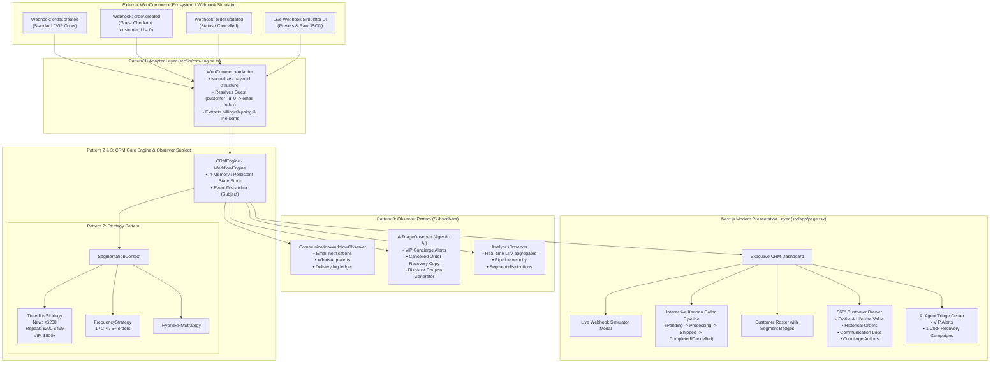

# CRM System Integration with WooCommerce: Implementation Plan & Architecture Diagram

## Executive Overview
This implementation plan defines the end-to-end architecture and implementation roadmap for integrating a high-performance **Customer Relationship Management (CRM) system** with **WooCommerce** in Next.js 16 (React 19 + Tailwind CSS).

The platform bridges e-commerce transaction streams with relationship management, automated omnichannel workflows, and autonomous **Agentic AI Triage**, engineered with explicit enterprise design patterns:
- **Adapter Pattern (`WooCommerceAdapter`)**: Decouples heterogeneous external WooCommerce webhook structures from internal CRM domain models, with intelligent guest checkout deduplication (`customer_id = 0` mapped by email).
- **Strategy Pattern (`SegmentationStrategy`)**: Enables dynamic runtime customer categorization (New, Repeat, VIP) based on configurable LTV, order frequency, and recency algorithms.
- **Observer Pattern (`WorkflowEngine`)**: Decouples state changes from side-effects, dispatching automated communication logs (Email, WhatsApp) and activating the **Embedded AI Triage Agent** for VIP concierge white-glove treatment and cart/order cancellation recovery.

---

## 1. System Architecture Diagram

---

## 2. Core Functional Requirements Breakdown

### 2.1 Customer Data Management
1. **WooCommerce Sync & Domain Normalization**:
   - Ingests WooCommerce customer objects and order payloads.
   - Extracts customer name, email, phone, billing address, and shipping address.
2. **Guest Checkout Resolution (`customer_id = 0`)**:
   - When WooCommerce emits an order with `customer_id: 0`, the `WooCommerceAdapter` extracts `billing.email` as the immutable entity key.
   - Matches against existing CRM customer records:
     - If customer exists (either from previous guest order or account creation), aggregates new order into existing profile.
     - If new, instantiates a CRM customer profile with tag `["Guest Checkout"]` and associates the order.
3. **Dynamic Lifetime Value (LTV) & Metrics**:
   - `LTV`: Cumulative sum of non-cancelled/non-refunded order totals (`total_spent`).
   - `AOV`: Average Order Value = `LTV / valid_orders_count`.
   - `Purchase Frequency` & `Last Active Date`.
4. **Auto-Segmentation**:
   - Evaluated automatically after every order transition via `SegmentationStrategy`.
   - Categories:
     - **New**: 1 order, LTV < $200.
     - **Repeat**: 2+ orders, LTV $200 - $499.99.
     - **VIP**: LTV ≥ $500 or 5+ orders.
5. **360° Customer Drawer**:
   - Slide-over comprehensive drawer displaying:
     - Avatar, Full Name, Contact info, Tags, Segment badge.
     - Lifetime metrics (LTV, AOV, Total Orders, First & Latest purchase timestamps).
     - Full order history list with direct links and item breakdowns.
     - Communication log history (emails & WhatsApp messages sent).
     - Direct actions (Send manual WhatsApp, Add internal note, Re-run AI triage).

### 2.2 Order Tracking & Real-Time Pipeline
1. **Pipeline Lifecycle Stages**:
   - `Pending` ➔ `Processing` ➔ `Shipped` ➔ `Completed` (or `Cancelled`).
2. **Interactive Status Updates**:
   - Kanban board columns + Table view toggle.
   - Interactive advance button (e.g. "Move to Processing", "Dispatch / Shipped", "Complete Delivery", "Cancel Order").
   - Instant optimistic UI update + Event emission through `WorkflowEngine`.
3. **Order Detail View**:
   - Modal/drawer showing itemized products (SKU, title, quantity, price), customer cross-link, payment gateway, tracking info.

### 2.3 Communication Workflows & Agentic AI
1. **Automated Communication Workflows**:
   - `Order Created` ➔ Triggers "Order Confirmation" Email and "Order Received" WhatsApp message.
   - `Processing` ➔ Triggers "Packaging Update" WhatsApp message.
   - `Shipped` ➔ Triggers "Out for Delivery" Email + WhatsApp with simulated tracking link.
   - `Completed` ➔ Triggers "Delivered - Feedback Request" Email.
   - `Cancelled` ➔ Triggers AI recovery workflow.
2. **Embedded AI Triage Agent**:
   - **VIP Concierge Alert**:
     - Activates when an order comes from a VIP customer or elevates a customer to VIP status.
     - Generates priority briefing: customer profile, spending habits, recommended concierge actions (e.g., "Add handwritten VIP gift note", "Upgrade to priority overnight courier", "Assign dedicated account manager").
     - 1-Click "Dispatch Concierge Greeting".
   - **Cancelled-Order Discount Recovery Generator**:
     - Activates on order cancellation.
     - Analyzes abandoned order value and customer segment.
     - Synthesizes personalized recovery copy for Email & WhatsApp + unique discount promo code (e.g. `SAVE15-RECOVER`, `VIP-COMEBACK20`).
     - 1-Click "Send Recovery Offer" action.

### 2.4 Explicit Design Patterns in `src/lib/crm-engine.ts`
1. **Adapter Pattern (`WooCommerceAdapter`)**:
   - Translates raw WooCommerce JSON schemas (`wc_order`, `wc_customer`, `billing`, `shipping`, snake_case fields, string numbers) into strongly-typed CRM Domain models (`CrmOrder`, `CrmCustomer`, `CrmLineItem`).
   - Normalizes guest checkouts and generates consistent IDs.
2. **Strategy Pattern (`SegmentationStrategy`)**:
   - Defines `ISegmentationStrategy` interface.
   - Provides concrete implementations: `TieredLtvStrategy`, `OrderCountStrategy`, `HybridRfmStrategy`.
   - `SegmentationContext` dynamically executes strategy on customer profile update.
3. **Observer Pattern (`WorkflowEngine`)**:
   - `WorkflowEngine` acts as the Subject/Publisher.
   - Observers subscribe via `subscribe(observer: CrmObserver)`.
   - Dispatches `order:created`, `order:status_changed`, `order:cancelled`, `customer:vip_elevated`.
   - Observers: `CommunicationWorkflowObserver`, `AiTriageObserver`, `AnalyticsObserver`.

### 2.5 Automated Testing Suite
1. **Unit Tests (Vitest) in `src/lib/__tests__/crm-engine.test.ts`**:
   - `WooCommerceAdapter`: Standard payload transformation, Guest checkout (`customer_id: 0`) email mapping, malformed payload resilience.
   - `SegmentationStrategy`: Tiered LTV calculations, threshold boundaries ($199 vs $200, $499 vs $500), runtime strategy swapping.
   - `WorkflowEngine` (Observer): Subscription, multi-observer broadcast, unsubscription, order state transition events.
   - `AiTriageAgent`: VIP alert triggering logic, cancellation discount generation.
2. **End-to-End Tests (Playwright) in `e2e/crm.spec.ts`**:
   - Dashboard loading and navigation.
   - Webhook Simulator triggering a Standard order, VIP order, Guest checkout order, and Cancelled order.
   - Verifying customer list auto-updates with correct segment badges.
   - Opening 360° Customer Drawer and verifying order timeline & communication logs.
   - Advancing an order through the pipeline stages (Pending ➔ Processing ➔ Shipped ➔ Completed).
   - Validating AI Triage alert generation and recovery actions.

### 2.6 Live Webhook Simulator UI
- Prominent interactive component on the dashboard with 4 one-click demo presets:
  1. `Standard Order ($89.00)` - New customer.
  2. `VIP Whale Order ($1,450.00)` - Instant VIP elevation & AI Concierge alert.
  3. `Guest Checkout Order ($120.00)` - `customer_id: 0` with email `sarah.guest@example.com`.
  4. `Order Cancellation ($340.00)` - Order cancellation triggering AI discount recovery.
- Plus a "Custom Payload" JSON editor modal allowing judges/evaluators to paste arbitrary WooCommerce webhook payloads.

### 2.7 Documentation Deliverables
- **`README.md`**: Updated with Scope Definition, System Architecture, Assumptions, Design Pattern Explanations, Agentic AI Workflows, and Test Execution commands.
- **`AI_USAGE.md`**: Complete log of AI agents, prompt strategies, architecture rationale, and validation criteria.

---

## 3. Implementation Steps & Milestones

| Milestone | Action Items | Files Involved |
|:---|:---|:---|
| **Phase 1: Environment & Engine Setup** | • Fix `package.json` scripts & test configs • Create `src/lib/types.ts` (Domain interfaces) • Implement `src/lib/crm-engine.ts` with Adapter, Strategy, & Observer patterns • Implement `src/lib/ai-triage.ts` (AI Concierge & Recovery agent) | `package.json`, `vitest.config.ts`, `src/lib/types.ts`, `src/lib/crm-engine.ts`, `src/lib/ai-triage.ts` |
| **Phase 2: Comprehensive Unit Testing** | • Write complete Vitest test suite covering all 3 design patterns, guest mapping, and AI triage • Run and verify Vitest passes 100% | `src/lib/__tests__/crm-engine.test.ts` |
| **Phase 3: Seed Data & Initial State** | • Build realistic WooCommerce sample orders, customers, and message logs for out-of-the-box demo | `src/lib/seed-data.ts` |
| **Phase 4: Modern Next.js UI Components** | • `Header & KPI Overview Cards` (Revenue, Orders, VIP Count, Conversion) • `WebhookSimulator` (Presets & Custom JSON trigger) • `OrderPipeline` (Kanban columns & status progression) • `CustomerTable` (Search, filter, segment badges) • `CustomerDrawer360` (Complete customer 360 view) • `AiTriageCenter` (VIP Concierge & Recovery actionable alerts) • `CommunicationFeed` (Email & WhatsApp live logs) | `src/app/page.tsx`, `src/components/*` |
| **Phase 5: E2E Playwright Suite** | • Write Playwright test suite in `e2e/crm.spec.ts` • Configure `playwright.config.ts` • Run and verify E2E tests | `playwright.config.ts`, `e2e/crm.spec.ts` |
| **Phase 6: Documentation** | • Update `README.md` with complete architecture, patterns, AI triage, setup • Create `AI_USAGE.md` | `README.md`, `AI_USAGE.md` |

---

## 4. Verification & Validation Checklist
- [ ] `npm run test` executes Vitest unit tests covering Adapter, Strategy, Observer, and AI Triage.
- [ ] `npm run build` compiles Next.js with zero TypeScript or linting errors.
- [ ] Webhook simulator reliably triggers all 4 preset order scenarios.
- [ ] Guest checkouts (`customer_id: 0`) merge correctly by email.
- [ ] LTV updates in real-time, automatically transitioning customer segments.
- [ ] AI Triage Agent produces VIP Concierge alerts and Cancelled Order recovery campaigns.
- [ ] `e2e/crm.spec.ts` passes with automated Playwright validation.
- [ ] `README.md` and `AI_USAGE.md` fully documented.
